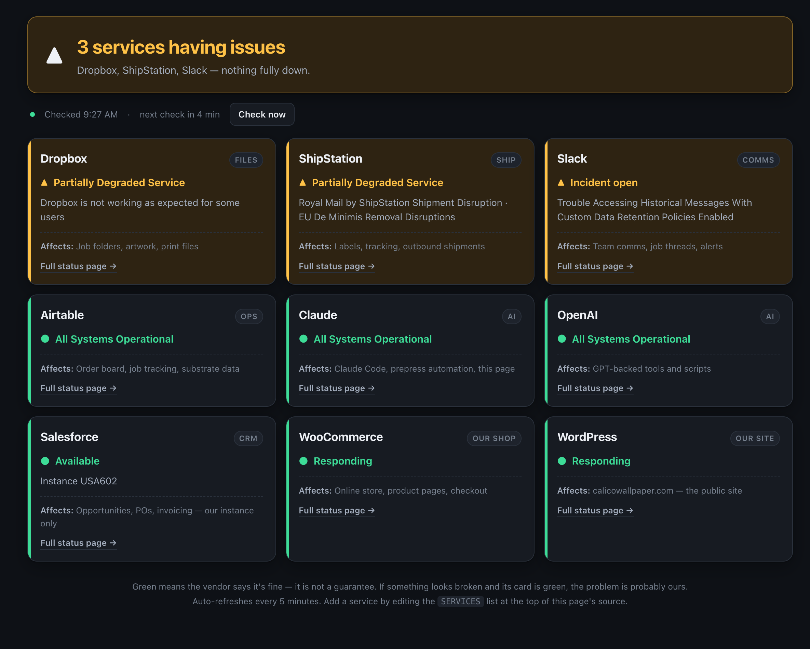

# Calico Service Status

One page that answers "is it us, or is it them?" — live status for the services Calico
production depends on. Built so nobody burns twenty minutes debugging an outage that
isn't ours.

**Live page:** https://ddopplercalico.github.io/calico-status/

Auto-refreshes every 5 minutes. Also re-checks when you come back to a tab that's been
sitting open, so a wall-mounted display never shows stale green.



## What it checks

| Service | How | Notes |
|---|---|---|
| Dropbox | Statuspage API | |
| Airtable | Statuspage API | |
| ShipStation | Statuspage API | |
| Salesforce | Instance API | Checks **USA602** — our instance, not the global feed |
| Slack | Slack status feed | |
| Claude | Statuspage API | |
| OpenAI | Statuspage API | |
| WordPress | Direct probe of `calicowallpaper.com/wp-json/` | No vendor status page exists |
| WooCommerce | Direct probe of our product API | Tests *our* store, not WooCommerce Inc. |

Everything is fetched client-side, straight from the vendor. There's no server, no build
step, no API keys, and nothing to keep running.

## Reading it

- **Green** — the vendor says it's fine. Not a guarantee. If something's broken and the
  card is green, the problem is probably ours.
- **Amber** — degraded or an open incident. Partial impact.
- **Red** — major outage.
- **Grey** — we couldn't reach the status feed. *Not* the same as "down" — the page never
  paints red on a guess. If everything goes grey at once, it's this machine's network.

Problem services sort to the top automatically, so the stuff you care about is always
in the first row.

## Adding a service

Edit the `SERVICES` array at the top of the `<script>` block in `index.html`. One line
per service. Four kinds are supported:

```js
// Any Atlassian Statuspage site — most vendors. Just give it the status domain.
{ name:'Figma', tag:'Design', kind:'statuspage', host:'status.figma.com',
  page:'https://status.figma.com', impact:'What breaks for us when this is down' },

// No vendor status page? Probe the thing itself. 200 = up.
{ name:'Our API', tag:'Internal', kind:'probe', url:'https://example.com/health',
  page:'https://example.com', impact:'...' },
```

`kind: 'slack'` and `kind: 'salesforce'` are one-offs for those two vendors' custom feeds.

**Finding a vendor's status domain:** try `https://status.<vendor>.com/api/v2/summary.json`
in a browser. If you get JSON with a `status.indicator` field, it's a Statuspage site and
`kind: 'statuspage'` will work. If not, use `kind: 'probe'` against something on their site.

A `probe` target has to allow cross-origin requests, or it'll read grey instead of green.

Commit and push — GitHub Pages redeploys in about a minute.

## Why not a Claude Artifact

Published artifacts run under a strict content-security policy that blocks every external
request, so an artifact physically cannot poll a status API. Hence a plain static page on
GitHub Pages: free, no server, and the browser is allowed to make the calls.
